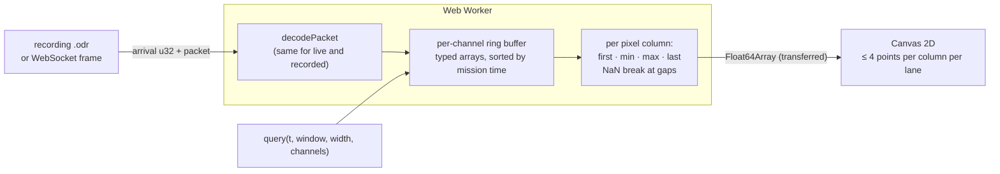

# orbit-desk

At mission time 04:18, battery voltage dips. Rewind thirty seconds, follow the power channels and see whether the spacecraft recovered.

[](https://github.com/AutumnTrace/orbit-desk/actions/workflows/ci.yml)
[](https://github.com/AutumnTrace/orbit-desk/actions/workflows/pages.yml)
[](LICENSE)

![Recording of the orbit-desk console on the battery-sag mission. Playing at 4× through 04:18, the battery voltage and bus voltage traces dip for a single sample and alarms appear in the left pane. Clicking the critical "Battery voltage below limit (23.90 V)" alarm moves the playhead to 04:18.385; the inspector on the right shows the EPS packet from 04:18.250 with 23.90 V and its bytes. Then the view rewinds thirty seconds, widens to 180 s and plays at 16×: the battery current returns from −9.5 A to −4.6 A at 04:26 and the voltage climbs back above its limits.](docs/media/incident.gif)

A telemetry console for SIMSAT-1, a fictional spacecraft. **All of its telemetry is simulated.**

- The left pane lists alarms. Clicking one seeks straight to it.
- The centre shows synchronized traces of the channels you pick, plus a keyboard-navigable table of the samples behind them.
- The inspector shows the raw packet under the playhead: header fields, values with units, sequence number, quality and bytes.
- The address bar always holds the mission, playhead, window, channels and packet, so a copied link reopens the same incident.

Packets are binary, with the [layout below](#the-packet). The same decoder reads three recorded missions in the browser, which is the GitHub Pages demo, and a live WebSocket stream from a small Node simulator. Decoding and data reduction run in a Web Worker; the main thread only draws.

**Open the incident:** <https://autumntrace.github.io/orbit-desk/?mission=battery-sag&t=04:18.500&span=60&ch=bat_v,bat_i,sa_i,bus_v&src=1>. That link works once the Pages workflow has deployed. Locally:

```sh
git clone https://github.com/AutumnTrace/orbit-desk && cd orbit-desk
npm ci && npm run build && npx vite preview
# http://localhost:4173/?mission=battery-sag&t=04:18.500&span=60&ch=bat_v,bat_i,sa_i,bus_v&src=1
```

## A 60-second walkthrough

1. **Open the incident link.** The playhead stands at 04:18.500.
   - Battery voltage reads **23.90 V**, and the lane says `window min 23.90 V`: one sample at 04:18.250, below the 24.5 V critical limit.
   - The inspector shows that sample's EPS packet, `#1033`, with header fields and bytes. Hover a byte to see which field it belongs to.
2. **Click the red "Battery voltage below limit (23.90 V)" alarm.** The playhead moves to 04:18.385, the moment that packet arrived on the ground, so the sample that raised the alarm is on screen.
3. **Rewind and follow.** Press **−30 s**, set the window to 180 s, choose **Power**, and press **Play** at 16×.
   - The heater that stuck on at 04:18.000 is shed at 04:26.
   - Battery current returns from −9.5 A to −4.6 A, and every power alarm clears.
   - The spacecraft recovered.
4. **Look at a gap.** Choose **Recorded: Antenna dropout** and type `t=05:40` into the address.
   - The COMMS lanes say `no data for 30.x s`, and the table ends in *No data since 05:09.500*. Nothing is drawn as zero.
   - Play on to 06:05. The EPS and ADCS packets stored on board during the outage arrive (marked ↻ retransmitted) and fill their gap. COMMS keeps its gap, because those packets were never sent.
5. **Share it.** **Copy link**, open it in a new window: same mission, time, window, channels and inspected packet, pixel for pixel.

Keyboard:

| Key | Action |
| --- | --- |
| Space | play or pause |
| ← / → | 1 s back or forward (with Shift: 10 s) |
| `[` / `]` | widen or narrow the window |
| `a` / `A` | next or previous alarm |
| ↑ ↓ PageUp PageDown Home End, Enter | walk the sample table and inspect a packet |

## Preserving the signal while drawing less



A 10-minute window of four 4 Hz channels holds about 9,600 samples. At 1600 px wide the trace area has about 800 columns. Three choices shape the reduction:

- **Keep extremes, not averages.** Per pixel column, the worker keeps the first, lowest, highest and last sample, in time order (the M4 approach). A single-sample dip is always one of those four, so it survives every zoom level. The 04:18 dip is visible at 15 s and at 600 s. Every point drawn is a real sample, never an average or interpolation.
- **Make gaps visible.**
  - Consecutive samples further apart than 1.5 × the source's cadence become a NaN break in the point list, so the line lifts and the gap is shaded.
  - A sample that hasn't *arrived* by the playhead counts as missing too, even if it was taken earlier.
  - A lane whose last value is old says how old it is.
  - Nothing ever fills a gap with zero or a held value.
- **Make the playhead a pure function.** At playhead t the engine answers from the packets whose arrival time is ≤ t, and keeps no playback state. Seeking to 04:30 and playing up to 04:30 therefore show the same values, alarms, table and pixels. Alarm transitions are evaluated in mission-time order and become visible once every sample up to them has arrived.

The worker returns about 4 × width points per lane, whatever the zoom, and transfers them instead of copying. The sample table is capped at the 200 rows nearest the playhead: with a 10-minute window, rendering all 2,400 rows had been what blocked the main thread.

## The packet

![Byte layout of a version 1 packet. The 16-byte header: magic 0x4F44 at offset 0 (2 bytes), version at 2, flags at 3 (bit 0 retransmitted), source at 4 (2 bytes: 1 EPS, 2 COMMS, 3 ADCS), sequence at 6 (2 bytes, per source, wrapping), mission time at 8 (4 bytes, milliseconds), payload length at 12 (2 bytes, 7 per sample), sample count at 14, reserved at 15. Then n samples of 7 bytes each: channel id (u16), value (f32), quality (u8: 0 good, 1 suspect, 2 bad). Then a CRC-16/CCITT-FALSE over everything before it. Recordings store each packet as arrival time u32, length u16, packet; a live WebSocket message is arrival time u32 then the packet.](docs/packet.svg)

The decoder ([`packet.ts`](src/telemetry/packet.ts)) returns a typed error per packet instead of throwing:

- `truncated`, `bad-magic`, `unsupported-version`;
- `length-mismatch`, `crc-mismatch`;
- `unknown-source`, `unknown-channel`, `bad-quality`, `not-finite`.

Each record or WebSocket message frames exactly one packet, so a damaged packet costs only itself. It is counted by kind (`3 invalid skipped (2 truncated, 1 crc-mismatch)`) and playback carries on.

The three recordings are generated from seeds by [`missions.ts`](src/sim/missions.ts):

| Mission | What happens |
| --- | --- |
| Normal orbit | Eclipse 02:30–06:30. The battery takes the load and recharges. No alarms. |
| Battery sag | At 04:18.000 a heater sticks on. At 04:18.250 one sample reads 23.9 V. The extra load holds the battery below its warning limit until fault protection sheds the heater at 04:26. |
| Antenna dropout | The downlink fades from 04:58 and is lost 05:10–05:50. COMMS has a real gap. EPS and ADCS from the outage are replayed from on-board storage after reacquisition, from 05:52, marked retransmitted. |

Each mission also has:

- packets that never arrive (0.2%);
- packets that arrive 1–4 s late (0.4%);
- a few that arrive damaged: a flipped payload bit, cut short, or garbage where the magic should be.

## Failure scenarios and the tests that pin them

| Scenario | What must happen | Test |
| --- | --- | --- |
| Seek back 30 s and replay to the same time, in all three missions | Values, views, alarms, stats, table and inspection identical to a linear run in 250 ms steps | [`seek back and replay matches a linear run`](tests/missions.test.ts#L70) |
| The same, in the browser | Clock, lanes, alarms, inspector, stats and canvas pixels identical | [`rewinding thirty seconds…`](e2e/console.spec.ts#L82) |
| A one-sample dip at widths 40–4,000 px and windows 0.5 s–9 min | The dip value is among the points drawn, and the lane minimum shows it | [`keeps a one-sample dip at every zoom level`](tests/signal.test.ts#L16) |
| The downsampler at all | Never emits a value that wasn't a sample; at most 4 points per column | [`never invents a value`](tests/signal.test.ts#L38) |
| Missing packets (lost, or not arrived yet) | A gap and a NaN break, never a zero | [`turns missing packets into a gap, not a zero`](tests/signal.test.ts#L52), [`treats a sample that has not arrived yet as missing`](tests/signal.test.ts#L64), [`never reports a missing sample as zero`](tests/missions.test.ts#L56) |
| Eleven malformed packets | Each rejected with its own error kind | [`rejects %s`](tests/packet.test.ts#L58) |
| An invalid packet mid-stream | Counted and skipped, the next packet decoded; in the browser, playback continues past it | [`an invalid packet costs only itself`](tests/packet.test.ts#L64), [`an invalid packet is counted and skipped…`](e2e/console.spec.ts#L93) |
| A copied link in a fresh browser context | The same incident, canvas pixels included | [`a copied link opens the same incident in a fresh tab`](e2e/console.spec.ts#L49) |
| Delayed packets into a full live ring, across the wrap point | Kept in mission-time order; memory fixed; oldest evicted | [`puts a delayed sample in its place, across the wrap point`](tests/signal.test.ts#L87) |
| Live mode against the simulator | Streams, follows the clock, shows the fixed buffer, raises alarms | [`live mode streams…`](e2e/console.spec.ts#L134) |
| The committed recordings | Regenerating them from their seeds gives the same bytes | [`are the seeded ones`](tests/missions.test.ts#L23) |
| Keyboard and screen readers | The sample table works from the keyboard; axe finds no serious violations | [`the sample table works from the keyboard`](e2e/console.spec.ts#L120), [`no serious accessibility violations`](e2e/console.spec.ts#L144) |

Two mutation checks back these up:

- With only first and last kept per column, the dip test fails.
- The browser replay test compares canvas pixels exactly. It caught a real bug while I was writing it: the table rendered one frame of stale rows with the new source's columns.

## Measured

Measured on Windows 11 with a Ryzen 7 9800X3D, Node 24.21.0, and Chromium 159.0.8154.6 headless at 1600×1000, DPR 1.

`npm run bench:decode` uses 11,239 records (0.5 MB) from the three missions:

| Measure | Result |
| --- | ---: |
| `decodePacket`, 449,560 packets (median of 5) | 6.3 million packets/s, 292 MB/s |
| Decode, ring insert and packet log (the live path), 112,390 packets | 2.8 million packets/s |
| Live ring capacity: 5 min of history, all 10 channels | 11,140 samples, 272 KiB, fixed |
| Samples evicted while streaming about 1.5 h of mission time through that ring | 348,822 |
| JS heap growth over that stream (approximate) | 4.4 MB |

`npm run build && npm run bench:chart` plays battery-sag from 07:00 at 16× for 4 s per window size, with 4 lanes. It records, per frame:

- the worker's compute time;
- the round trip from posting the query to receiving the answer;
- the canvas draw.

Times are from `performance.now()`, which the page coarsens to 0.1 ms.

| Window | Frames | Points drawn (p50) | Worker p50 / p95 | Round trip p50 / p95 | Draw p50 / p95 |
| ---: | ---: | ---: | ---: | ---: | ---: |
| 15 s | 242 | 180 | 0.1 / 0.2 ms | 0.2 / 0.3 ms | 0.5 / 0.7 ms |
| 60 s | 242 | 720 | 0.2 / 0.3 ms | 0.4 / 0.7 ms | 0.8 / 0.9 ms |
| 180 s | 242 | 2,160 | 0.3 / 0.5 ms | 0.6 / 0.9 ms | 0.8 / 1.0 ms |
| 600 s | 243 | 6,189 | 0.7 / 1.1 ms | 1.0 / 1.4 ms | 0.9 / 1.1 ms |

That is 60 frames per second at every window. Before the table cap, the 600 s row had a 20 ms round trip and dropped frames.

The test suites, on the same machine:

- 33 unit tests (Vitest) in 0.2 s;
- 9 browser tests (Playwright, Chromium) in about 15 s, also run 8 times in a row without a failure.

## Running it

Prerequisite: Node 24. Node runs the TypeScript simulator and scripts directly.

| Task | Command |
| --- | --- |
| Install | `npm ci` |
| Recorded demo (as on Pages) | `npm run build && npx vite preview`, then <http://localhost:4173> |
| Development server | `npm run dev` |
| Live mode | `npm run sim` (WebSocket on :8765), then choose **Live** in the mission menu, or open `/?live=ws://localhost:8765/?mission=battery-sag%26from=240%26speed=1` |
| Unit tests | `npm test` |
| Browser tests (builds, serves, starts the simulator) | `npx playwright install chromium && npm run e2e` |
| Types | `npm run typecheck` |
| Benchmarks | `npm run bench:decode`; `npm run build && npm run bench:chart` |
| Regenerate the recordings | `npm run missions` (a test checks they match the committed bytes) |
| Regenerate the diagram and recording | `node scripts/packet-diagram.ts`; `npm run build && npm run record` |
| Reset | Nothing persists. A reload with no query string starts the default incident; `npm run missions` rewrites the recordings from their seeds. |

## Three files worth reading

1. [`src/telemetry/downsample.ts`](src/telemetry/downsample.ts): the per-column first/min/max/last reduction, and how gaps and not-yet-arrived samples become line breaks.
2. [`src/telemetry/engine.ts`](src/telemetry/engine.ts): one engine for live and recorded data, with every answer a function of (packets arrived by t, t).
3. [`src/telemetry/ring.ts`](src/telemetry/ring.ts): a fixed-capacity ring of typed arrays that still accepts a late sample in mission-time order.

## Tradeoff, limitation, next step

**Tradeoff.** The engine recomputes each frame from the data instead of updating state as the playhead moves. Seek-equals-replay is therefore true by construction and testable, at the cost of rescanning the window every frame. At these sizes that is under a millisecond; at hours of history per lane it would not be. The alarm list is recomputed only when data arrives, not per frame.

**Known limitation.** Live mode keeps 5 minutes per channel. Rewinding further shows a gap where evicted data was, and live links are not shareable: packet ids and arrival times depend on when you connected. Only recorded missions make reproducible URLs.

**Next step.** A min/max pyramid per channel: pre-reduced levels at 2×, 4×, 8×… the base cadence, built as samples arrive. A wide window would then read about one level-appropriate bucket per column instead of rescanning every sample. That is the change that lets the same frame budget hold for day-long passes.

## Scope

- Fictional spacecraft, simulated telemetry, seeded faults. Nothing here comes from a real mission.
- The engineering point is drawing less without losing the signal, not flight software.

## License

[MIT](LICENSE)
